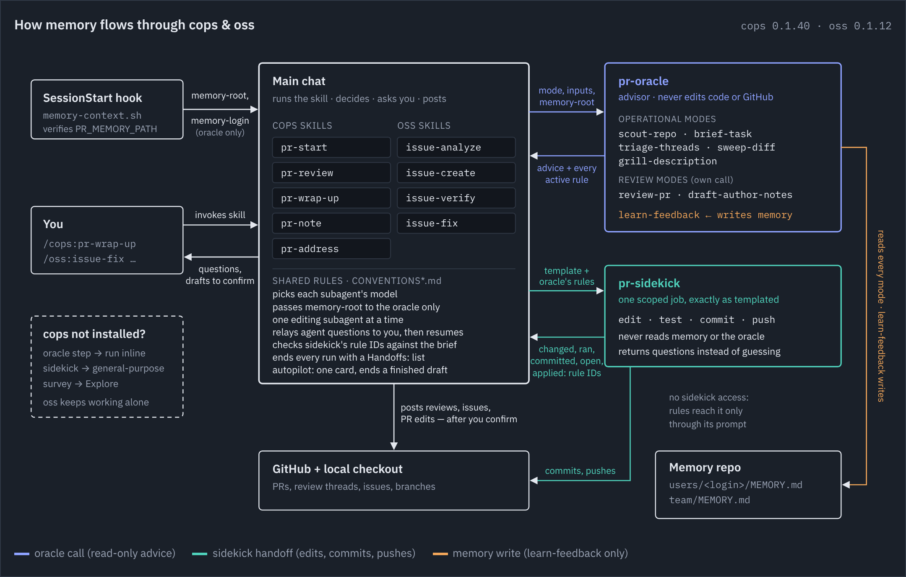

# ai-skills

AI skills kit — a plugin marketplace for Claude Code and Cursor.

## Plugins

### OSS


[`oss/`](oss/) — maintaining and contributing to open source projects. Claude Code: `/oss:<skill-name>`, e.g. `/oss:issue-verify`. Cursor: `/issue-verify`. Works on its own; install `cops` too to add the memory and agents ([`CONVENTIONS-orchestration.md`](CONVENTIONS-orchestration.md#companion-plugin-cops)).

#### Skills

- [`issue-analyze`](oss/skills/issue-analyze/SKILL.md) — sizes an issue and reasons about its root cause, read-only.
- [`issue-create`](oss/skills/issue-create/SKILL.md) — drafts and files a bug report after you confirm it.
- [`issue-verify`](oss/skills/issue-verify/SKILL.md) — reproduces an issue and pushes the failing test as a checkpoint.
- [`issue-fix`](oss/skills/issue-fix/SKILL.md) — fixes a verified issue from that checkpoint, after you pick an option.

### Code Ops


[`cops/`](cops/) — working with pull requests. Claude Code: `/cops:<skill-name>`, e.g. `/cops:pr-start` or `/cops:pr-sync`. Cursor: `/pr-sync`.

#### Skills

- [`pr-start`](cops/skills/pr-start/SKILL.md) — turns a confirmed task into a pushed draft PR.
- [`pr-review`](cops/skills/pr-review/SKILL.md) — drafts labeled review comments and posts one review after you confirm.
- [`pr-sync`](cops/skills/pr-sync/SKILL.md) — rebases an open PR and updates its title, description, and changeset.
- [`pr-note`](cops/skills/pr-note/SKILL.md) — leaves inline notes explaining choices on your own PR.
- [`pr-address`](cops/skills/pr-address/SKILL.md) — addresses unresolved review threads on your PR.

#### Agents

Used by both plugins' skills (`cops:pr-oracle` / `cops:pr-sidekick` in Claude Code, subagents in Cursor):

- [`pr-oracle`](cops/agents/pr-oracle.md) — remembers recurring review themes, profiles repository setup, and drafts complete PR reviews and author notes.
- [`pr-sidekick`](cops/agents/pr-sidekick.md) — runs the implement/test/commit loops skills hand off, applying the remembered rules the oracle picks for each job.



## Install

After installing `cops`, follow its [Setup](cops/README.md#setup), or the short version in [Environment setup](#environment-setup) below.

### Claude Code

Add the marketplace, then install the plugin(s) you want:

```
/plugin marketplace add eddeee888/ai-skills
/plugin install oss
/plugin install cops
```

Local checkout for development:

```
claude --plugin-dir ./oss
claude --plugin-dir ./cops
```

### Cursor

**Anyone / yourself:** add the GitHub catalog, then install `oss` and/or `cops` from Customize or the CLI `/plugin` Marketplace tab:

```
cursor-agent plugin marketplace add https://github.com/eddeee888/ai-skills
```

**Team / Enterprise:** [Dashboard → Plugins → Add Marketplace → Import from Repo](https://cursor.com/docs/plugins), paste `https://github.com/eddeee888/ai-skills`, review `oss` and `cops`, set access and Default Off / On / Required. Optionally enable Auto Refresh (needs the [Cursor GitHub App](https://cursor.com/docs/integrations/github.md) on this repo).

**Official public listing (optional):** submit this repo at [cursor.com/marketplace/publish](https://cursor.com/marketplace/publish). Manual review; the repo must stay public and open source.

Local checkout for development: copy `oss` and `cops` into `~/.cursor/plugins/local/` (do not symlink from outside that folder) and reload the window.

## Environment setup

> [!NOTE]
> `oss` on its own needs only [GitHub access](#github-access); it has no settings. Everything else here belongs to `cops`, and `oss` skills pick it up when `cops` is installed too: memory reaches them through `pr-oracle`, and the model tiers apply to the subagents they call. With nothing configured, the skills run without memory on the host's default models.

### GitHub access

- **`gh` CLI** — the skills use it when it's logged in (`gh auth login`); the [COPS HQ pane](cops/README.md#cops-hq-pane) needs it for review threads.
- **GitHub MCP server** — the skills fall back to it without `gh`, and the `pr-oracle` agent reads GitHub only through it, so connect it even if you have `gh`.

### Memory repository

`pr-oracle` keeps remembered rules in a separate Git repository you own; COPS never creates, clones, pulls, commits, or pushes it. Details: [Workspace memory](cops/README.md#workspace-memory).

1. Create a Git repository (e.g. `agent-memory`). The oracle writes under:

   ```text
   memory/users/<github-login>/MEMORY.md     # your active rules
   memory/users/<github-login>/candidates.md # reviewer-derived, inactive until promoted
   memory/team/MEMORY.md                     # shared rules, written only on `record-team:`
   ```

2. Make it available next to the code repository:
   - **Local:** clone it anywhere, e.g. `~/code/agent-memory`.
   - **Claude Code on the web / cloud sessions:** add it as an extra repository on the environment (or session), so it's checked out beside the main repo, at `/home/user/<repo-name>` (e.g. `/home/user/agent-memory`).
   - **Cursor:** include it in the workspace.
3. Point COPS at it:

   | Setting | Claude Code | Cursor | Value |
   | --- | --- | --- | --- |
   | Memory path | plugin option `memory_path`, or env `PR_MEMORY_PATH` | plugin variable `PR_MEMORY_PATH` | Git root of the memory repo: absolute, `~/…`, or `$HOME/…` |
   | Memory login | plugin option `memory_login`, or env `PR_MEMORY_LOGIN` | plugin variable `PR_MEMORY_LOGIN` | Your GitHub login; names `memory/users/<login>/`. Never guessed — unset means team memory only |

   The env variables win over the plugin options. In a Claude Code cloud environment, set them in the environment's variables:

   ```text
   PR_MEMORY_PATH=/home/user/agent-memory
   PR_MEMORY_LOGIN=<your-github-login>
   ```

4. Commit and push memory changes yourself; the [status line](cops/README.md#status-line) shows uncommitted and unpushed counts. In a cloud session, push before the container is reclaimed or the changes are lost.

   ```text
   memory: ✗ (off)                                    # memory not loaded: no path set (✗ (bad path) when it isn't a Git root)
   memory: octocat · self 12/200 · team 40/200        # memory loaded with login, everything committed and pushed
   memory: octocat · self 12/200 · team 40/200 · 2 uncommitted · 1 unpushed
   ```

   The last line is memory with local changes: `uncommitted` counts modified and untracked files, `unpushed` counts commits not on the upstream yet. A path without a login shows `memory: ✗ (no login)`.

The session-start hook prints the result: `COPS memory root: …` and `COPS memory login: …` when both are valid, or `COPS memory not configured` / `COPS memory unavailable` (the path isn't a Git root) / `COPS memory login unset`.

### Subagent models

Each subagent call runs at a tier; set a tier's model with an env variable ([Subagent models](cops/README.md#subagent-models)):

| Variable | Used for | Claude Code default |
| --- | --- | --- |
| `COPS_MODEL_LIGHT` | sorting, extracting, mechanical edits | `haiku` |
| `COPS_MODEL_STANDARD` | reading, drafting, scoped changes | `sonnet` |
| `COPS_MODEL_DEEP` | finding bugs, cross-file judgment | `opus` |

Any model name the host accepts for a subagent works; `inherit` runs on the session's model. Unset, empty, or invalid values fall back to the default. Cursor can't set a model per call, so every tier there is `inherit`. The session-start hook prints the resolved values as `COPS models: light=… standard=… deep=…`.

### Putting it together

Claude Code, in `~/.claude/settings.json` (for a cloud environment, put the same values in its variables, with `PR_MEMORY_PATH=/home/user/agent-memory`):

```json
{
  "env": {
    "PR_MEMORY_PATH": "~/code/agent-memory",
    "PR_MEMORY_LOGIN": "<your-github-login>",
    "COPS_MODEL_LIGHT": "haiku",
    "COPS_MODEL_STANDARD": "sonnet",
    "COPS_MODEL_DEEP": "inherit"
  }
}
```

Then run a skill, e.g. `/cops:pr-review <PR URL>`: its report ends with a `Handoffs:` list, where `✓` means the agents ran and `inline (…)` means a step ran in the main chat instead.

### Development tools

`bash scripts/validate.sh` needs Bash, `jq`, and Perl; rendering the diagram also needs pnpm (see [Development](#development)).

## Layout

- Catalogs: [`.claude-plugin/marketplace.json`](.claude-plugin/marketplace.json) (Claude Code), [`.cursor-plugin/marketplace.json`](.cursor-plugin/marketplace.json) (Cursor).
- Each plugin: `.claude-plugin/plugin.json` and `.cursor-plugin/plugin.json` manifests; skills in `skills/<skill-name>/SKILL.md`.
- [`CONVENTIONS.md`](CONVENTIONS.md) and its six indexed reference files hold rules shared by more than one skill (e.g. the `[package-name]` monorepo title prefix), so skills point to them instead of restating them. Rules marked *Default* can be overridden by a repo's `CLAUDE.md`, the oracle's memory, or the current conversation; the rest are contracts. An installed plugin only gets its own directory, so `oss/` and `cops/` each carry identical copies of all seven files — edit the root set, then copy it over both.

## Development

Run the repository checks (requires Bash, `jq`, and Perl):

```bash
bash scripts/validate.sh
```

To render the diagram, install the locked dependencies first:

```bash
pnpm install
```

### Updating the diagram

The diagram in [Plugins](#plugins) is [`docs/memory-flow.png`](docs/memory-flow.png), rendered from [`docs/memory-flow.html`](docs/memory-flow.html) by `pnpm render:memory-flow` (needs `jq` and pnpm). The script stamps plugin versions from the manifests, so a version bump only needs a re-run. When skills, agents, or memory access change, give an agent this prompt:

```text
Update docs/memory-flow.html so the diagram matches the current code. Read
cops/agents/*.md, cops/hooks/memory-context.sh, CONVENTIONS-orchestration.md,
cops/skills/*/SKILL.md, oss/skills/*/SKILL.md and
cops/references/pr-oracle/modes/*.md. Show only the access paths the code
allows, and label every arrow with what passes along it. Keep the layout,
colors, legend, and the COPS skills in PR lifecycle order (pr-start,
pr-review, pr-sync, pr-note, pr-address). Run `pnpm render:memory-flow`, look at
docs/memory-flow.png, then commit and push.
```
